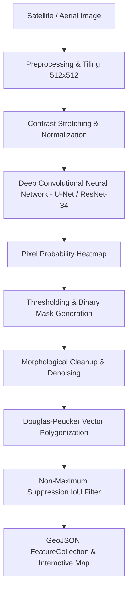

# GeoBuild AI — Building Detection from Satellite Images

> **AI-powered satellite image analysis platform for intelligent building detection, semantic footprint extraction, and geospatial insights.**

[](#)
[](#)
[](#)
[](#)

---

## 📌 Project Overview

**GeoBuild AI** is an advanced Geospatial AI platform designed for automated building footprint extraction and built-up area analysis from high-resolution satellite and aerial imagery. Built to bridge computer vision research with practical geospatial applications, it provides an end-to-end workflow from image ingestion and preprocessing to neural segmentation, polygon regularization, and interactive GIS mapping.

### 🎯 Key Objectives
- **Automated Feature Extraction:** Eliminate manual digitizing of building footprints from remote sensing data.
- **Urban Growth Monitoring:** Support municipal planning, illegal construction tracking, and disaster vulnerability mapping.
- **Academic Demonstration:** Provide an intuitive, production-grade interface for college project evaluations, research demonstrations, and geospatial analysis.

---

## 🛰️ Architecture & AI Pipeline



1. **Input Ingestion:** High-resolution RGB satellite imagery (Sentinel-2, Maxar, Planet, or aerial orthophotos).
2. **Preprocessing:** Overlapping tile extraction (512×512 patches with 25% stride overlap) and radiometric normalization.
3. **Inference Engine:** Encoder-Decoder CNN (U-Net with ResNet-34 backbone) classifying building pixels vs. background.
4. **Post-Processing:**
   - Morphological operations (dilation/erosion) to bridge fragmented walls and close roof holes.
   - Non-Maximum Suppression (NMS) to eliminate edge duplication between adjacent tiles.
   - Douglas-Peucker algorithm to regularize jagged raster contours into sharp architectural vector polygons.
5. **Geospatial Visualization:** Vector polygon overlay onto Leaflet.js interactive maps with multi-layer switching (Esri Satellite, CartoDB Dark, OpenStreetMap).

---

## 💻 Tech Stack

| Layer | Technologies |
|---|---|
| **Frontend Core** | HTML5 Semantic Architecture, Modern Vanilla JavaScript (ES2023 Modules) |
| **Styling & Design System** | Custom Vanilla CSS (Design Tokens, Dark/Light Themes, Glassmorphism, Micro-animations) |
| **Interactive GIS** | Leaflet.js (OpenStreetMap, Esri World Imagery, Vector Polygon Layer) |
| **Data Analytics** | Chart.js (Confidence Distribution Doughnut, Building Area Histograms) |
| **AI/ML Concepts** | Semantic Segmentation (U-Net, DeepLabV3+, Mask R-CNN), OpenCV, Computer Vision |
| **Export Formats** | GeoJSON (RFC 7946), CSV Footprint Records, JSON Telemetry, Printable PDF Reports |

---

## 🚀 Key Features

- **Dynamic Landing Page:** Hero section, platform statistics, technology highlights, interactive FAQ, and direct demo access.
- **Executive Dashboard:** Live KPI stat cards (Images Analyzed, Buildings Detected, Projects Created), recent activity timeline, and quick-launch actions.
- **Upload Studio:** Drag-and-drop file upload zone, file validation (format & size checks), instant image preview, and preloaded sample satellite datasets (Urban, Residential, Commercial, Mixed Use).
- **Detection Workspace:** Multi-scale tile configuration, contrast/denoise enhancements, real-time confidence threshold slider (10%–95%), model selection, and multi-stage animated processing simulation.
- **Results Studio:**
  - Side-by-side comparison with interactive before/after split drag slider.
  - Multi-layer visualizer: Original Image, Detected Vector Polygons, Mask Heatmap, and Combined Composite.
  - Opacity adjustment slider for detection overlay.
  - One-click file exports: **GeoJSON**, **CSV**, **JSON**, and printable **Full Report**.
- **Interactive Geospatial Map:** Leaflet map with satellite/street basemap toggle, color-coded confidence polygons, popups with building metadata, and ROI reset.
- **Projects Management:** Multi-project organization, project card grid, and interactive creation modal.
- **Detection History:** Searchable, filterable, and sortable tabular detection log with direct download and deletion capabilities.
- **Settings & Preferences:** Academic profile configuration, model inference defaults, GIS CRS selection (WGS 84 / Web Mercator), and theme customizer (Deep Space Dark vs. Academic Light).
- **Educational About Page:** Remote sensing overview, AI pipeline breakdown, real-world smart city applications, and future research roadmap.

---

## ⚡ Quick Start / Local Setup

GeoBuild AI runs natively in any modern web browser without heavy external dependencies.

### Step 1: Start Local Server
Run with Python (built-in):
```bash
# Navigate to project directory
cd "geobuild-ai"

# Launch local HTTP server
python -m http.server 8080
```

### Step 2: Open in Browser
Visit `http://localhost:8080` in Chrome, Edge, Firefox, or Safari.

### Step 3: Instant Demo Evaluation
Click **"Explore Demo"** on the landing page or **"⚡ Instant Demo Sign-In"** on the login page to immediately access the full platform with pre-populated geospatial datasets.

---

## 🎓 Academic Viva & Presentation Q&A Guide

| Question | Recommended Answer |
|---|---|
| **Q1: Why use U-Net for building detection?** | U-Net's encoder-decoder architecture with skip connections preserves fine-grained spatial details from shallow layers while capturing high-level context in deep layers, which is crucial for sharp building boundaries. |
| **Q2: How do you handle varied building shapes and roof colors?** | Multi-scale training, data augmentation (rotations, color jittering), and multi-spectral inputs (NIR/NDVI bands) help distinguish roofs from roads and bare soil. |
| **Q3: What is the purpose of polygon simplification?** | Raw segmentation masks produce jagged, stair-stepped pixel edges. Applying the Douglas-Peucker algorithm regularizes them into clean polygons suitable for GIS cadastre databases. |
| **Q4: How does the system scale to large satellite scenes?** | Large satellite scenes (e.g., 10,000×10,000 pixels) are partitioned into overlapping tiles (512×512), processed in batches, and re-stitched using Non-Maximum Suppression to remove boundary artifacts. |

---

## 📄 License
Developed for academic demonstration and research purposes under the **MIT Academic License**.
